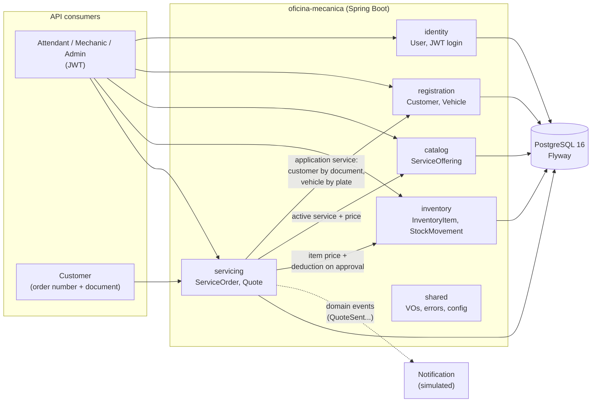
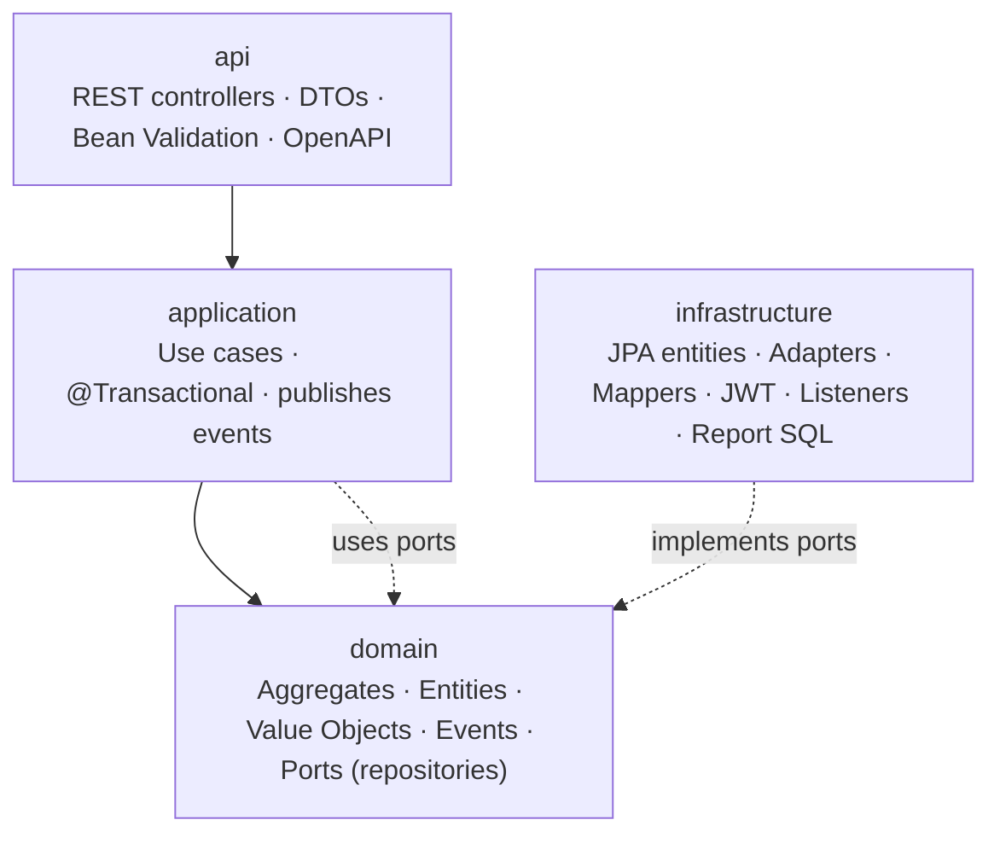

# Auto Repair Shop — Back-end (Tech Challenge SOAT · Phase 1)

REST API to manage a mid-sized auto repair shop that currently tracks everything in spreadsheets.
The system covers the full service flow of a vehicle: **opening the service order, diagnosis, quote,
customer approval, execution and delivery**, plus customer and vehicle registration, the service
catalog and the parts and supplies inventory.

- **DDD / Event Storming board (Miro):** _[board link](https://miro.com/app/board/PLACEHOLDER)_
- **Demo video:** _[video link](https://youtu.be/PLACEHOLDER)_

> The code (packages, classes, endpoints, JSON fields and database) is in English. Messages returned
> to API users are in Portuguese, since the shop and its customers are Brazilian.

---

## Contents

1. [Goal](#goal)
2. [Solution overview](#solution-overview)
3. [Architecture](#architecture)
4. [Technologies](#technologies)
5. [Prerequisites](#prerequisites)
6. [Running](#running)
7. [Tests and coverage](#tests-and-coverage)
8. [API documentation (Swagger)](#api-documentation-swagger)
9. [Demo users and token](#demo-users-and-token)
10. [Full flow with curl](#full-flow-with-curl)
11. [Database: why PostgreSQL](#database-why-postgresql)
12. [Security and quality](#security-and-quality)
13. [Directory structure](#directory-structure)
14. [Further documentation](#further-documentation)

---

## Goal

Replace the shop's spreadsheets with a system that:

- records each service in a **service order** with a readable number (`OS-2026-000123`);
- **generates the quote automatically** from the diagnosed services and parts;
- lets the **customer track the order and approve or reject the quote** through the API;
- **deducts parts from stock** when the quote is approved, never allowing a negative balance;
- keeps the **status history** of each order and provides indicators such as the **average execution time**.

## Solution overview

| Flow | How it works |
|---|---|
| **Opening the order** | The attendant provides the (already registered) customer's CPF/CNPJ and the license plate. If the plate does not exist, the vehicle is registered on the fly. Initial services and parts can be added; the current price is stored in the item. |
| **Diagnosis** | `RECEIVED → IN_DIAGNOSIS`. Services and parts can only be added or removed up to this point. |
| **Quote** | Completing the diagnosis (requires at least one service) generates the quote with the items total and **sends it to the customer** (`QuoteSent` event + simulated notification in the log). The order goes to `AWAITING_APPROVAL`. |
| **Approval** | The customer approves (order number + document). The order goes to `IN_PROGRESS` and the parts are **deducted from stock in the same transaction**. If stock is missing: HTTP 422 and nothing changes. |
| **Rejection** | The quote becomes `REJECTED`, the reason is recorded and the order goes to `FINISHED` without execution and without touching stock. |
| **Execution and delivery** | `IN_PROGRESS → FINISHED → DELIVERED`. |
| **Report** | Average time between `IN_PROGRESS` and `FINISHED`, overall and per service, with a period filter. |

Every status transition records history (previous status, new status, timestamp and actor) and
publishes a domain event. Invalid transitions return **409**. Concurrent writes to the same order or
inventory item are blocked by **optimistic locking** (`@Version` → 409).

## Architecture

**Modular monolith driven by DDD**, with one package per bounded context and internal layers
(`domain` → `application` → `infrastructure` / `api`). `domain` is plain Java (no Spring/JPA).
Contexts only talk through **application services** or **domain events**, never through another
context's repository. Details in the [ADRs](docs/adr/README.md).





Error responses follow **RFC 7807 (`ProblemDetail`)**: 400 validation · 401 unauthenticated ·
403 forbidden · 404 not found · 409 conflict/transition/concurrency · 422 business rule.

## Technologies

| Category | Technology |
|---|---|
| Language / build | Java 21, Maven (`mvnw` wrapper) |
| Framework | Spring Boot 3.5 (Web, Data JPA, Validation, Security, OAuth2 Resource Server, Actuator) |
| Authentication | JWT HS256 (Nimbus, via `spring-security-oauth2-resource-server`), BCrypt passwords |
| Database | PostgreSQL 16 + Flyway |
| Documentation | springdoc-openapi (Swagger UI) |
| Tests | JUnit 5, Mockito, AssertJ, MockMvc, Testcontainers (PostgreSQL) |
| Coverage | JaCoCo, build fails below 80% (lines and branches) in `domain` and `application` |
| Security | OWASP Dependency-Check, Trivy |
| Infra | Docker (multi-stage, JRE 21 Alpine, non-root user), Docker Compose, GitHub Actions |

## Prerequisites

- **Docker** and **Docker Compose** (to run everything in containers and for the integration tests);
- **Java 21**, only to run or test outside Docker (Maven comes with the `mvnw` wrapper).

## Running

### 1. Configure the environment

```bash
cp .env.example .env
# edit .env: database passwords, JWT_SECRET (>= 32 characters) and demo user passwords
# suggestion for the secret: openssl rand -base64 48
```

`.env` is in `.gitignore` and must **never** be committed.

### 2a. Everything with Docker (recommended)

```bash
docker compose up --build
```

Starts PostgreSQL (with volume and healthcheck) and the application (`docker` profile), which only
starts after the database is healthy. The API is available at `http://localhost:8080` (port
configurable through `APP_PORT`). Flyway migrations and sample data (services and inventory items)
are applied on startup.

### 2b. Locally (IDE or terminal)

```bash
docker compose up -d postgres     # database only
./mvnw spring-boot:run            # Windows: .\mvnw.cmd spring-boot:run
```

Without an explicit profile, the application uses the **`dev`** profile, which reads `.env`, loads the
sample data and creates the demo users (with a default password when the variable is not set).

### Profiles

| Profile | Use | Database | Sample data | Demo user password |
|---|---|---|---|---|
| `dev` (default) | local run | `localhost` (reads `.env`) | yes | variable or default `admin123` / `atendente123` |
| `docker` | `docker compose` | `postgres` service | yes | **must** come from a variable |
| `test` | automated tests | Testcontainers | no | fixed in the tests |

Health check: `GET http://localhost:8080/actuator/health`.

## Tests and coverage

```bash
./mvnw verify          # Windows: .\mvnw.cmd verify
```

- **Unit**: every value object (valid and invalid CPF/CNPJ, old and Mercosur plates, money, e-mail,
  phone), the service order state machine (every valid transition and each operation in every invalid
  status), quote calculation, inventory rules and use cases with mocks.
- **Integration** (Testcontainers + real PostgreSQL 16): full order flow until delivery, rejection,
  approval without stock (with rollback check), authentication (401 without token, 403 with the wrong
  role), customer public tracking, CRUDs, report and optimistic locking.
- Docker must be running for the integration tests.

Coverage report: **`target/site/jacoco/index.html`**. The JaCoCo rule fails the build if any
`domain`/`application` package drops below **80%** of lines or branches. Configuration classes, DTOs,
JPA entities and the `main` class are excluded from the calculation.

## API documentation (Swagger)

- Swagger UI: **http://localhost:8080/swagger-ui.html**
- OpenAPI (JSON): http://localhost:8080/v3/api-docs

To call protected endpoints in Swagger: run `POST /api/v1/auth/login`, copy the `token`, click
**Authorize** and paste it. There is also a ready-made collection at
[`docs/api/workshop.http`](docs/api/workshop.http) (VS Code REST Client / IntelliJ HTTP Client).

### Endpoints

| Group | Endpoints | Access |
|---|---|---|
| Authentication | `POST /auth/login` | public |
| Customers | `POST/GET /customers`, `GET/PUT/DELETE /customers/{id}` | ADMIN, ATTENDANT |
| Vehicles | `POST/GET /vehicles?customerId=`, `GET/PUT/DELETE /vehicles/{id}` | ADMIN, ATTENDANT |
| Services | `GET /services?active=`, `GET /services/{id}` · `POST`, `PUT`, `DELETE` (deactivates) | read: both · write: ADMIN |
| Inventory | `GET /inventory-items`, `/inventory-items/{id}`, `/inventory-items/low-stock`, `/inventory-items/{id}/movements` · `POST`, `PUT`, `DELETE`, `POST /inventory-items/{id}/stock-in`, `POST /inventory-items/{id}/stock-out` | read: both · write: ADMIN |
| Service orders | `POST/GET /service-orders` (paginated: `status`, `customerId`, `from`, `to`, `page`, `size`), `GET /service-orders/{id}` | ADMIN, ATTENDANT |
| Order items | `POST /service-orders/{id}/services`, `DELETE /service-orders/{id}/services/{serviceId}`, `POST /service-orders/{id}/parts`, `DELETE /service-orders/{id}/parts/{inventoryItemId}` | ADMIN, ATTENDANT |
| Transitions | `POST /service-orders/{id}/start-diagnosis`, `/complete-diagnosis`, `/finish`, `/deliver` | ADMIN, ATTENDANT |
| Reports | `GET /reports/average-execution-time?from=&to=` | ADMIN |
| Customer (public) | `GET /public/service-orders/{number}?document=`, `POST /public/service-orders/{number}/quote/approve` and `/reject` | order number + document |

Every path above has the `/api/v1` prefix.

## Demo users and token

The users are created on startup (`dev` and `docker` profiles) if they do not exist yet:

| Role | E-mail (variable) | Password (variable) | Default in `dev` |
|---|---|---|---|
| ADMIN | `admin@oficina.com` (`DEMO_ADMIN_EMAIL`) | `DEMO_ADMIN_PASSWORD` | `admin123` |
| ATTENDANT | `atendente@oficina.com` (`DEMO_ATTENDANT_EMAIL`) | `DEMO_ATTENDANT_PASSWORD` | `atendente123` |

The `docker` profile has no default password: it must be in `.env`. To get a token:

```bash
curl -s -X POST http://localhost:8080/api/v1/auth/login \
  -H "Content-Type: application/json" \
  -d '{"email":"admin@oficina.com","password":"admin123"}'
# {"token":"eyJhbGciOiJIUzI1NiJ9...","type":"Bearer","expiresAt":"..."}
```

Send the token in the `Authorization: Bearer <token>` header. Default expiration is 2 hours (`JWT_EXPIRATION`).

## Full flow with curl

Prerequisites: application running and `jq` installed. Service and inventory item ids come from the
sample data (`db/seed`).

```bash
API=http://localhost:8080/api/v1
TOKEN=$(curl -s -X POST $API/auth/login -H "Content-Type: application/json" \
  -d '{"email":"admin@oficina.com","password":"admin123"}' | jq -r .token)
AUTH="Authorization: Bearer $TOKEN"
JSON="Content-Type: application/json"

# 1. Create the customer
curl -s -X POST $API/customers -H "$AUTH" -H "$JSON" -d '{
  "name":"Maria da Silva","document":"529.982.247-25",
  "email":"maria@email.com","phone":"(11) 98888-7777"}'

# 2. Open the order: new vehicle + oil change + 4 L of oil + filter
ORDER=$(curl -s -X POST $API/service-orders -H "$AUTH" -H "$JSON" -d '{
  "customerDocument":"529.982.247-25",
  "vehicle":{"licensePlate":"ABC1D23","brand":"Volkswagen","model":"Gol","year":2020},
  "services":[{"id":"11111111-0000-0000-0000-000000000001"}],
  "parts":[{"id":"22222222-0000-0000-0000-000000000001","quantity":4},
           {"id":"22222222-0000-0000-0000-000000000002"}]}')
ID=$(echo $ORDER | jq -r .id); NUMBER=$(echo $ORDER | jq -r .number); echo "Order $NUMBER"

# 3. Diagnosis and quote
curl -s -X POST $API/service-orders/$ID/start-diagnosis -H "$AUTH" | jq .status
curl -s -X POST $API/service-orders/$ID/complete-diagnosis -H "$AUTH" -H "$JSON" \
  -d '{"notes":"Oil expired and filter clogged"}' | jq '.status, .quote'

# 4. The customer tracks and approves (no token)
curl -s "$API/public/service-orders/$NUMBER?document=52998224725" | jq '.status, .totalAmount'
curl -s -X POST $API/public/service-orders/$NUMBER/quote/approve -H "$JSON" \
  -d '{"document":"529.982.247-25"}' | jq .status          # IN_PROGRESS (stock deducted)

# 5. Execution and delivery
curl -s -X POST $API/service-orders/$ID/finish  -H "$AUTH" | jq .status   # FINISHED
curl -s -X POST $API/service-orders/$ID/deliver -H "$AUTH" | jq .status   # DELIVERED

# 6. History, inventory and report
curl -s $API/service-orders/$ID -H "$AUTH" | jq '.history[] | {newStatus, changedAt, actor}'
curl -s $API/inventory-items/low-stock -H "$AUTH" | jq '.[] | {code, stockQuantity, minimumStock}'
curl -s "$API/reports/average-execution-time" -H "$AUTH" | jq .
```

To reject: `POST $API/public/service-orders/$NUMBER/quote/reject` with
`{"document":"...","reason":"..."}`.

> **Windows (Git Bash):** the terminal may not send accented characters as UTF-8 in `curl` arguments
> (the API answers 400 "JSON malformado... fora do padrão UTF-8"). Send such bodies from a UTF-8 file
> (`--data-binary @body.json`) or use [`docs/api/workshop.http`](docs/api/workshop.http).

## Database: why PostgreSQL

| Domain need | How PostgreSQL meets it |
|---|---|
| Approve the quote and deduct several parts atomically | **ACID** transactions: if one item lacks stock, nothing is written |
| Unique license plate, document, item code and order number | `UNIQUE` constraints enforced by the database, including under concurrency |
| Orders referencing customer, vehicle, services and items | **Referential integrity** with foreign keys |
| Balance and prices never negative | `CHECK` constraints as a second line of defense |
| Readable sequential order number | Native `SEQUENCE` |
| Reports over the history | Rich SQL (CTEs, aggregations, `EXTRACT(EPOCH ...)`) |
| Tests faithful to production | Native **Testcontainers** support (same database in tests and production) |
| Operations | Maturity, open source, wide adoption and official Docker Hub images |

The schema is versioned with **Flyway** (`src/main/resources/db/migration`) and Hibernate only
validates it (`ddl-auto=validate`).

## Security and quality

- Stateless JWT with the secret coming **only** from an environment variable (`JWT_SECRET`, validated
  on startup); `ADMIN` and `ATTENDANT` roles; BCrypt passwords.
- No secrets in the repository: `.env` ignored and `.env.example` documented.
- Input validated in two layers: Bean Validation in DTOs and value objects in the domain.
  JPA entities are never exposed by controllers.
- Public endpoints do not reveal other customers' orders (404) nor internal data.
- **CI** (`.github/workflows/ci.yml`): build, tests, JaCoCo coverage rule, OWASP Dependency-Check
  and Trivy on the Docker image, with reports published as artifacts.
- Vulnerability analysis: [`docs/security/vulnerability-analysis.md`](docs/security/vulnerability-analysis.md).

## Directory structure

```
.
├── .github/workflows/ci.yml          # CI pipeline
├── docs/
│   ├── adr/                          # architecture decision records
│   ├── api/workshop.http             # request collection for the full flow
│   ├── ddd/                          # ubiquitous language, domain model, event storming
│   └── security/                     # vulnerability reports and analysis
├── src/main/java/br/com/oficina/
│   ├── shared/                       # shared kernel: VOs, exceptions, ProblemDetail, OpenAPI
│   ├── identity/                     # users, login, JWT
│   ├── registration/                 # customers and vehicles
│   ├── catalog/                      # service catalog
│   ├── inventory/                    # parts/supplies and stock movements
│   └── servicing/                    # service order, quote, report, notification
│       ├── domain/                   #   aggregate, VOs, events, ports
│       ├── application/              #   use cases
│       ├── infrastructure/           #   JPA, report SQL, listeners
│       └── api/                      #   controllers and DTOs
├── src/main/resources/
│   ├── db/migration/                 # Flyway migrations (V1..V5)
│   ├── db/seed/                      # sample data (dev/docker)
│   └── application*.properties       # dev and docker profiles (test lives in src/test)
├── src/test/java/...                 # unit and integration tests (Testcontainers)
├── Dockerfile · docker-compose.yml · .env.example
└── pom.xml · mvnw
```

## Further documentation

- [Ubiquitous language](docs/ddd/ubiquitous-language.md): glossary business term (PT) → code (EN)
- [Domain model](docs/ddd/domain-model.md): aggregates, VOs, events, context map and diagrams
- [Event Storming](docs/ddd/event-storming.md): opening, tracking and inventory flows
- [ADRs](docs/adr/README.md): architecture decisions
- [Vulnerability analysis](docs/security/vulnerability-analysis.md)
