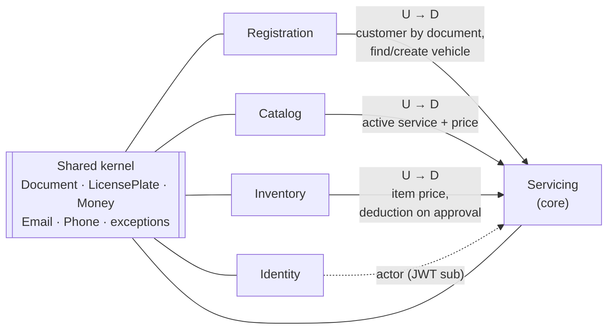
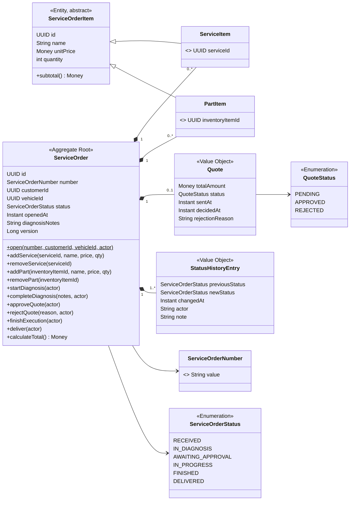
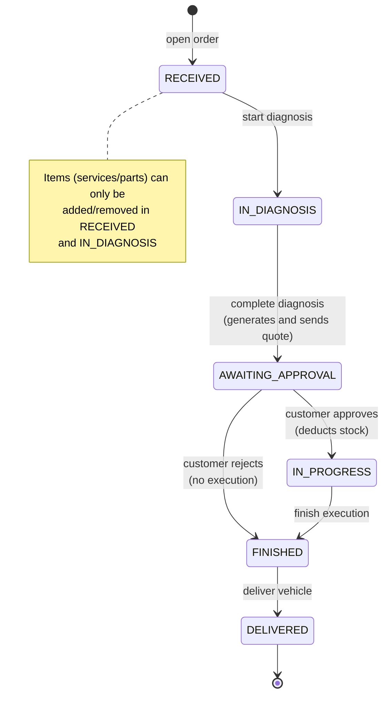

# Domain model

## Bounded contexts and context map

| Context | Responsibility | Package |
|---|---|---|
| **Servicing** (core domain) | Service order, quote, history, customer tracking and report | `servicing` |
| **Registration** (supporting) | Customers and vehicles | `registration` |
| **Catalog** (supporting) | Offered services and base prices | `catalog` |
| **Inventory** (supporting) | Parts, supplies, balances and movements | `inventory` |
| **Identity** (generic) | Internal users, roles and authentication | `identity` |
| **Shared kernel** | Common value objects, base exceptions, events | `shared` |

Servicing is **downstream** (D) of Registration, Catalog and Inventory (U = upstream): it consumes
their application services (`CustomerService`, `VehicleService`, `CatalogService`,
`InventoryItemService`, `StockService`) and **copies** into the aggregate only what it needs (name and
price at that moment). Later changes to the catalog or inventory therefore do not alter quoted
orders. No context accesses another context's repositories.

## Service order aggregate

**Invariants protected by the aggregate**

- Services and parts can only change in `RECEIVED` or `IN_DIAGNOSIS`.
- The diagnosis cannot be completed without at least one service (422).
- The quote is generated once, with the items total, and decided once.
- Each operation requires a source status; any other transition is invalid (409).
- Every transition records a `StatusHistoryEntry` and registers a domain event.
- Concurrent writes are detected through `version` (409).

## Service order state machine

## Other aggregates and entities

| Element | Type | Context | Main rules | Code |
|---|---|---|---|---|
| Customer | Aggregate | Registration | Unique, immutable document; valid name, e-mail and phone | `registration.domain.Customer` |
| Vehicle | Aggregate | Registration | Unique, immutable plate; year between 1900 and next year; belongs to a customer | `registration.domain.Vehicle` |
| Service offering | Aggregate | Catalog | Base price ≥ 0; estimated time > 0; soft delete | `catalog.domain.ServiceOffering` |
| Inventory item | Aggregate | Inventory | Unique code; balance never negative; changes only through movements; `version` | `inventory.domain.InventoryItem` |
| Stock movement | Immutable entity | Inventory | Quantity > 0; records the balance after the operation | `inventory.domain.StockMovement` |
| User | Aggregate | Identity | Unique e-mail; BCrypt password; ADMIN or ATTENDANT role | `identity.domain.User` |

## Value objects

| Value object | Rules | Code |
|---|---|---|
| Document / Cpf / Cnpj | Check digits; masked or unmasked input; stores digits only | `shared.domain.valueobject.*` |
| LicensePlate | Old and Mercosur formats; normalized to uppercase without hyphen | `shared.domain.valueobject.LicensePlate` |
| Money | `BigDecimal`, scale 2, non-negative; add, subtract, multiply | `shared.domain.valueobject.Money` |
| Email / Phone | Valid format; lowercase e-mail; phone with 10 or 11 digits | `shared.domain.valueobject.*` |
| ServiceOrderNumber | `OS-YYYY-NNNNNN` | `servicing.domain.ServiceOrderNumber` |
| Quote | Immutable; single decision (PENDING → APPROVED/REJECTED) | `servicing.domain.Quote` |
| StatusHistoryEntry | Immutable; default actor `system` | `servicing.domain.StatusHistoryEntry` |

## Domain events

Published by `ServiceOrderWriter` after saving the aggregate; listeners run after commit.

| Event | When | Policy / reaction | Code |
|---|---|---|---|
| `ServiceOrderOpened` | order opened | audit | `servicing.domain.event.ServiceOrderOpened` |
| `DiagnosisStarted` | RECEIVED → IN_DIAGNOSIS | audit | `...event.DiagnosisStarted` |
| `QuoteSent` | diagnosis completed | **notify the customer** (simulated) | `...event.QuoteSent` |
| `QuoteApproved` | customer approves | audit (the stock deduction is synchronous, in the same transaction) | `...event.QuoteApproved` |
| `ExecutionStarted` | together with the approval | audit | `...event.ExecutionStarted` |
| `QuoteRejected` | customer rejects | audit | `...event.QuoteRejected` |
| `ExecutionFinished` | IN_PROGRESS → FINISHED | audit | `...event.ExecutionFinished` |
| `VehicleDelivered` | FINISHED → DELIVERED | notify the customer (simulated) | `...event.VehicleDelivered` |

## Commands, actors and policies

| Command | Actor | Precondition | Result (event) | Endpoint / code |
|---|---|---|---|---|
| Open order | Attendant | customer registered | `ServiceOrderOpened` | `POST /service-orders` · `ServiceOrderService.open` |
| Add/remove service or part | Attendant/Mechanic | RECEIVED or IN_DIAGNOSIS | — | `POST/DELETE /service-orders/{id}/services` and `/parts` |
| Start diagnosis | Mechanic | RECEIVED | `DiagnosisStarted` | `POST /service-orders/{id}/start-diagnosis` |
| Complete diagnosis | Mechanic | IN_DIAGNOSIS + ≥ 1 service | `QuoteSent` | `POST /service-orders/{id}/complete-diagnosis` |
| Approve quote | Customer | AWAITING_APPROVAL + enough stock | `QuoteApproved`, `ExecutionStarted` | `POST /public/service-orders/{number}/quote/approve` |
| Reject quote | Customer | AWAITING_APPROVAL | `QuoteRejected` | `POST /public/service-orders/{number}/quote/reject` |
| Finish execution | Mechanic | IN_PROGRESS | `ExecutionFinished` | `POST /service-orders/{id}/finish` |
| Deliver vehicle | Attendant | FINISHED | `VehicleDelivered` | `POST /service-orders/{id}/deliver` |
| Register stock in/out | Administrator | enough balance (out) | movement | `POST /inventory-items/{id}/stock-in` and `/stock-out` |

**Policies** ("when X, then Y"):

1. When the diagnosis is completed, **generate the quote** with the items total and **send it to the customer**.
2. When the quote is approved, **deduct the parts from stock** in the same transaction; if stock is
   missing, refuse the approval.
3. When the quote is rejected, **finish the order without execution** and without moving stock.
4. When an item's balance reaches or goes below the minimum, it shows up in **low stock**.

## Actors

| Actor | Interaction |
|---|---|
| **Attendant** (`ATTENDANT`) | Registers customers and vehicles, opens orders, records diagnosis, finishes and delivers |
| **Mechanic** | Performs diagnosis and services (uses the `ATTENDANT` role in the MVP) |
| **Administrator** (`ADMIN`) | Everything the attendant does + service catalog, inventory and reports |
| **Customer** | Tracks the order and approves or rejects the quote (order number + document) |
| **System** | Generates the quote, sends notifications, deducts stock |
