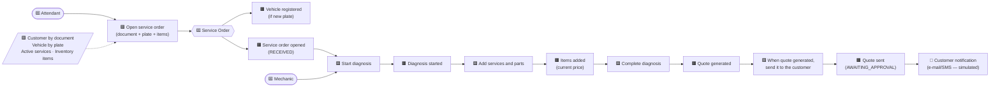
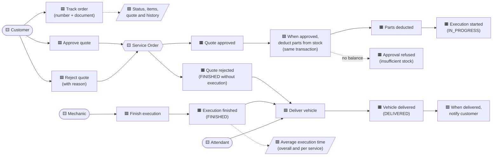
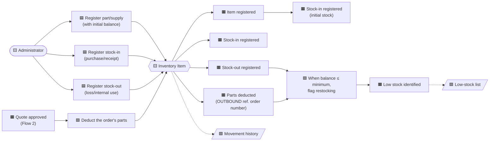

# Event Storming

Text base for the Miro board. Event Storming color convention:

| Sticky note | Color | Meaning |
|---|---|---|
| Event | 🟧 orange | Something that happened, in the past tense (e.g. *Quote sent*) |
| Command | 🟦 blue | An actor's intention (e.g. *Approve quote*) |
| Actor | 🟨 yellow | Who triggers the command |
| Policy | 🟪 lilac | Reactive rule: "when *event*, then *command*" |
| Aggregate | 🟨 light yellow | Who decides and protects the rules |
| Read model | 🟩 green | Information consulted to decide |
| External system | 🩷 pink | Integration outside the system |
| Hotspot | 🟥 red | Question, risk or rule to confirm |

---

## Flow 1 — Opening a service order

| # | Actor | Command | Aggregate | Event(s) | Rules / hotspots |
|---|---|---|---|---|---|
| 1 | Attendant | Open order | Service Order (+ Vehicle) | *Vehicle registered*, *Service order opened* | Customer must be registered; plate of another customer → refused (422) |
| 2 | Mechanic | Start diagnosis | Service Order | *Diagnosis started* | Only from RECEIVED |
| 3 | Mechanic/Attendant | Add/remove service or part | Service Order | *Items added/removed* | Only in RECEIVED/IN_DIAGNOSIS; inactive service → refused |
| 4 | Mechanic | Complete diagnosis | Service Order | *Quote generated*, *Quote sent* | Requires ≥ 1 service; 🟥 a part without stock does not block the quote (only the approval) |

Code: `ServiceOrderService.open`, `addService`, `addPart`, `startDiagnosis`, `completeDiagnosis`;
`CustomerNotificationListener.notifyQuoteSent`.

---

## Flow 2 — Tracking the service order (customer and shop)

| # | Actor | Command | Event(s) | Rules / hotspots |
|---|---|---|---|---|
| 1 | Customer | Track order | — | Number + document must match; otherwise "not found" (404) |
| 2 | Customer | Approve quote | *Quote approved*, *Parts deducted*, *Execution started* | Only in AWAITING_APPROVAL; missing stock refuses everything (422) |
| 3 | Customer | Reject quote | *Quote rejected* | Reason required; does not move stock |
| 4 | Mechanic | Finish execution | *Execution finished* | Only in IN_PROGRESS |
| 5 | Attendant | Deliver vehicle | *Vehicle delivered* | Only in FINISHED |
| — | Administrator | Check average time | — | Read model from the history; 🟥 rejected orders are excluded |

Code: `CustomerTrackingService.track/approveQuote/rejectQuote`, `ServiceOrderService.finish/deliver`,
`ReportService.averageExecutionTime`.

---

## Flow 3 — Parts and supplies management

| # | Actor | Command | Event(s) | Rules / hotspots |
|---|---|---|---|---|
| 1 | Administrator | Register part/supply | *Item registered*, *Stock-in registered* | Unique code; initial balance becomes an INBOUND movement |
| 2 | Administrator | Register stock-in | *Stock-in registered* | Quantity > 0 |
| 3 | Administrator | Register stock-out | *Stock-out registered* | Cannot make the balance negative (422) |
| 4 | System | Deduct the order's parts | *Parts deducted* | Validates every item before deducting; concurrency via version (409) |
| 5 | System | Flag restocking | *Low stock identified* | Balance ≤ minimum; 🟥 reserving parts when added to the order is an evolution (RESERVATION/REVERSAL) |

Code: `InventoryItemService.createItem/registerStockIn/registerStockOut/listLowStockItems`,
`StockService.deduct`, `InventoryItem.move`.
